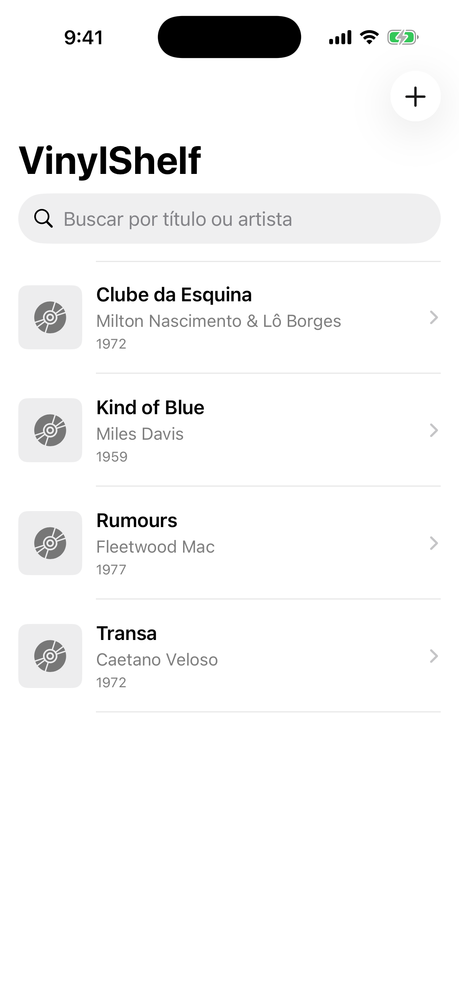
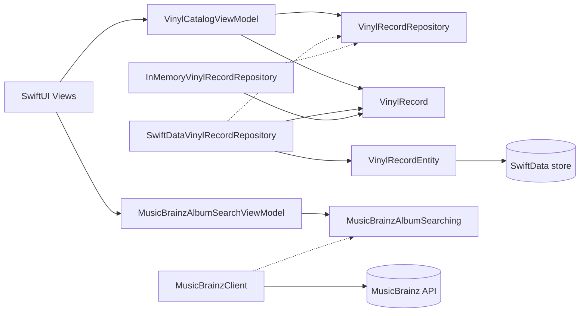

# VinylShelf

VinylShelf is a native iOS application for organizing a personal vinyl record
collection. It provides a focused catalog experience while keeping domain
logic, persistence, and presentation concerns clearly separated.

<p align="center">
  
</p>

<p align="center">
  <sub>Captured from the real application running in the iOS Simulator.</sub>
</p>

## Features

- Browse a catalog ordered consistently by title, artist, and identifier.
- Add records with a native form and validation for required and optional
  fields.
- Edit existing records while preserving their UUIDs.
- Delete records through swipe actions and a confirmation dialog.
- Search the loaded collection by title or artist, ignoring letter case and
  diacritics.
- Search MusicBrainz release groups by album title from the add-record form.
- Select a MusicBrainz result to prefill title, artist, and release year,
  while keeping review and saving under the user's control.
- Open a read-only detail screen for each record.
- Persist the collection locally with SwiftData.
- Handle loading, empty collection, no search results, and repository error
  states.
- Display native SF Symbols when album artwork is unavailable.

## Tech stack

| Area | Technology |
| --- | --- |
| Language | Swift 6 |
| User interface | SwiftUI, Observation (`@Observable`) |
| Persistence | SwiftData |
| Networking | URLSession, URLComponents, Codable |
| Concurrency | async/await, actors, `@MainActor`, `@ModelActor` |
| Testing | Swift Testing |
| Package management | Swift Package Manager |
| Project generation | XcodeGen |
| Continuous integration | GitHub Actions on macOS runners |
| Minimum deployment target | iOS 17.0 |

No third-party runtime dependencies are used.

## Architecture

VinylShelf follows MVVM with a repository boundary between presentation and
data access.



- **Views** render screen state and own presentation concerns such as sheets,
  navigation, search, swipe actions, and confirmation dialogs.
- **`VinylCatalogViewModel`** runs on the main actor, exposes observable state,
  coordinates CRUD operations, and depends on the repository protocol rather
  than a concrete database.
- **`VinylRecord`** is the immutable, sendable domain model shared through
  `VinylShelfCore`.
- **`VinylRecordRepository`** defines asynchronous CRUD operations without
  importing SwiftUI or SwiftData.
- **`SwiftDataVinylRecordRepository`** is the production implementation. Its
  `@ModelActor` keeps SwiftData context access isolated.
- **`InMemoryVinylRecordRepository`** is an actor-based implementation used by
  unit tests and the deterministic screenshot mode.
- **`MusicBrainzAlbumSearchViewModel`** owns remote-search UI state, cancels
  superseded tasks, and rejects responses from older search generations.
- **`MusicBrainzClient`** implements the injected album-search contract with
  URLSession, JSON decoding, an identifiable User-Agent, and a shared request
  rate limiter.

### Domain and persistence models

`VinylRecord` and `VinylRecordEntity` are intentionally separate:

- `VinylRecord` belongs to the cross-platform domain package and contains no
  persistence framework annotations.
- `VinylRecordEntity` is an iOS-specific SwiftData `@Model` responsible for
  stored properties and conversion to and from the domain value.

This separation prevents storage details from leaking into business logic and
allows repository implementations to change without changing the catalog or
its ViewModel.

### External album search

The MusicBrainz integration is independent of `VinylRecordRepository` and
SwiftData. The client searches album release groups and maps the external JSON
to `MusicBrainzAlbumSearchResult`. Selecting a result only copies available
title, artist, and year values into the existing form; it does not create a
record or write to persistence. The user can review and edit the values before
the normal save flow creates a `VinylRecord`.

A MusicBrainz release group represents the general concept of a musical
release, not a specific physical vinyl pressing.

## Project structure

```text
.
├── VinylShelf/                         # SwiftUI app, ViewModels, and iOS persistence
├── VinylShelfCore/
│   ├── Sources/VinylShelfCore/         # Domain, repositories, filtering, HTTP client
│   └── Tests/VinylShelfCoreTests/      # Cross-platform tests and JSON fixtures
├── VinylShelfTests/                    # ViewModel, form, and SwiftData repository tests
├── .github/
│   ├── workflows/
│   │   ├── ios-build.yml               # Build and test workflow
│   │   └── ios-screenshots.yml         # Manual simulator screenshot workflow
│   └── scripts/
│       └── validate-screenshot.swift   # Screenshot edge-band validator
├── docs/screenshots/                   # Real simulator screenshots
└── project.yml                         # XcodeGen project specification
```

`VinylShelf.xcodeproj` is generated by XcodeGen and is intentionally excluded
from version control.

## Getting started

The iOS application requires macOS. The cross-platform `VinylShelfCore`
package can also be built and tested on Windows, but SwiftUI, SwiftData, Xcode,
and the iOS Simulator are not available natively there.

### Requirements

- A Mac with an Xcode version that supports Swift 6 and an iOS 17 or later
  Simulator runtime.
- XcodeGen.
- Homebrew, if using the installation command below.

### Generate and run the app

From the repository root:

```bash
brew install xcodegen
xcodegen generate
open VinylShelf.xcodeproj
```

In Xcode:

1. Select the `VinylShelf` scheme.
2. Choose an iOS Simulator.
3. Run the application with **Product > Run** or `Command-R`.

Regenerate the project after changing `project.yml`; do not edit the generated
project as the source of truth.

## Testing

The test suite is divided by platform responsibility.

### VinylShelfCore tests

The package tests cover:

- Domain model initialization, optional values, and equality.
- In-memory repository CRUD behavior and repository-specific errors.
- Title and artist filtering, including case- and diacritic-insensitive
  matching.
- MusicBrainz URL construction, JSON decoding, optional fields, network and
  HTTP errors, and empty responses using mocks and JSON fixtures.

Run them from the repository root on macOS:

```bash
swift test --package-path VinylShelfCore
```

The current Windows development environment uses the native SwiftPM build
system as a temporary compatibility workaround:

```powershell
cd VinylShelfCore
swift build --build-system native
swift test --build-system native
```

### iOS target tests

The `VinylShelfTests` target covers:

- ViewModel loading, sorting, CRUD coordination, and error states.
- Form validation, input normalization, and UUID preservation during edits.
- MusicBrainz search states, explicit submission, cancellation, stale-response
  protection, and assisted form filling.
- SwiftData repository CRUD behavior using an in-memory `ModelContainer`.

Automated tests use injected fakes and local fixtures; they do not call the
live MusicBrainz service.

Run the iOS tests on macOS after generating the project:

```bash
xcodebuild \
  -project VinylShelf.xcodeproj \
  -scheme VinylShelf \
  -configuration Debug \
  -destination 'platform=iOS Simulator,name=iPhone 17 Pro,OS=latest' \
  CODE_SIGNING_ALLOWED=NO \
  test
```

The simulator name must exist in the installed Xcode version. The same tests
can also be run from the `VinylShelf` scheme in Xcode.

## Continuous integration and screenshots

### iOS Build

`.github/workflows/ios-build.yml` runs on pushes, pull requests, and manual
dispatches. On a macOS runner it:

1. Installs XcodeGen and generates the Xcode project.
2. Runs the `VinylShelfCore` package tests.
3. Builds the application for the iOS Simulator without code signing.
4. Runs the `VinylShelfTests` target in an iOS Simulator.

This workflow provides iOS build and test validation when development is done
from Windows.

### iOS Screenshots

`.github/workflows/ios-screenshots.yml` is a manually triggered workflow that
builds and installs the app in an iOS Simulator. A Debug-only launch argument,
`--screenshot-demo`, selects deterministic records from the in-memory
repository without modifying the user's SwiftData store.

The workflow waits for an application readiness signal, captures the catalog,
rejects screenshots with abnormal black edge bands, and uploads the accepted
PNG as the `vinylshelf-ios-screenshots` artifact.

To generate and download a screenshot:

1. Open the repository's **Actions** tab on GitHub.
2. Select **iOS Screenshots**.
3. Choose **Run workflow**.
4. Open the completed workflow run.
5. Download `vinylshelf-ios-screenshots` from the **Artifacts** section.

The workflow retains the artifact for 30 days. The screenshot shown at the top
of this README was produced by this simulator workflow and then added to
`docs/screenshots/`.

## Technical decisions

- **Separate domain and persistence models:** the domain remains independent
  of SwiftData and reusable outside the iOS target.
- **Protocol-based dependency injection:** the ViewModel accepts any
  `VinylRecordRepository`, and remote search depends on
  `MusicBrainzAlbumSearching`. This keeps persistence and networking
  replaceable while making tests deterministic.
- **Actor isolation:** the in-memory repository is an actor, the SwiftData
  repository uses `@ModelActor`, and UI state is isolated with `@MainActor`.
- **In-memory search:** filtering runs over already loaded records, avoiding a
  persistence query for every character entered while keeping the current
  collection size and feature scope simple.
- **Isolated external integration:** MusicBrainz uses URLSession and Codable in
  `VinylShelfCore`, without access to SwiftData or the CRUD repository.
- **Explicit remote requests:** album searches run only after user submission.
  A shared actor enforces request spacing, while task cancellation and search
  generations prevent stale responses from replacing newer results.
- **Assisted, manual import:** selecting external metadata only prefills the
  form. Missing values stay empty, and persistence still requires review and
  an explicit save action.
- **Incremental delivery:** domain, repositories, persistence, CRUD, search,
  navigation, and tooling were introduced as focused increments with tests
  where behavior was testable.
- **Generated Xcode project:** `project.yml` is the reviewable source of truth,
  while GitHub Actions regenerates the project for every macOS build.

## Future improvements

The following ideas are not implemented yet:

- Add pagination and richer query controls to MusicBrainz search.
- Download, cache, and display album artwork.
- Add configurable sorting and filtering options.
- Expand record metadata, such as label, catalog number, format, or condition.
- Add UI tests and broader accessibility coverage.
- Optionally synchronize or back up a collection across devices.
